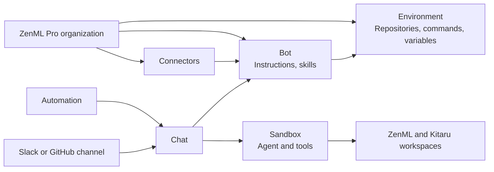

# Core concepts

This page defines the building blocks of Bots and how they relate to each
other and to ZenML Pro. For an overview of what Bots do, see the
[Bots overview](bots.md).

## ZenML Pro organizations, workspaces, and users

Bots are organized around ZenML Pro concepts rather than introducing their
own tenants.

* **Organization**: every bot, environment, chat, automation, channel, and
  connector belongs to exactly one ZenML Pro
  [organization](organization.md). Bot, environment, and automation names
  are unique within an organization.
  Resources of one organization are never visible from another.
* **Users**: you sign in to Bots with your ZenML Pro account. Every chat,
  bot, environment, and automation records the user that created it as its
  owner.
* **Workspaces**: Bots do not belong to a single
  [workspace](workspaces.md). Instead, each bot acts as a ZenML Pro
  [service account](service-accounts.md). When a chat starts, ZenML Pro looks
  up the workspaces that service account can read and logs the ZenML and Kitaru
  CLIs and SDKs in the sandbox in to them. The agent sees the list of these
  workspaces, and asks you which one to work on when your prompt does not make
  it clear.
* **Permissions**: who may read, use, update, or delete Bots resources is
  decided by ZenML Pro roles. Bots can be shared with individual users and
  [teams](teams.md). See [Bots roles and permissions](bots-rbac.md).

## Chats

A chat is one conversation with an agent about one task. It is the unit you
work with most: you start it with a prompt, follow the agent's progress in it,
steer it, and review its results there.

A chat has:

| Property | Meaning |
| --- | --- |
| Name | Derived from the first prompt. You can rename the chat. |
| Summary | Generated from the conversation as it progresses |
| Bot | The bot the chat runs as |
| Status | What the agent is doing right now, see below |
| Sandbox status | Whether the chat's sandbox is starting, running, or stopped |
| Owner | The account that started the chat |
| Origin | Started from the UI or API, by an automation, or from a Slack or GitHub thread |

### Starting a chat

You start a chat with a prompt. A prompt is text plus optional context:

* **Attachments**: files you upload with the prompt, within limits on their
  number and size.
* **External resources**: references to things the prompt is about. These can
  be a URL, a GitHub URL, a ZenML Pro workspace, or a ZenML resource such as
  a project, pipeline, pipeline run, artifact version, model version,
  snapshot, deployment, stack, or stack component. Kitaru resources such as
  sessions, agents, cohorts, investigations, experiments, evaluators, and
  session comparisons are supported as well.

If you do not choose a bot, ZenML Pro selects one from the bots you are
allowed to use, based on the prompt and the bot descriptions. With only one
usable bot, that bot is used.

You can later find chats by the external resources they were given or
produced, for example all chats about a specific pipeline run.

### Chat status

| Status | Meaning |
| --- | --- |
| `running` | The agent is working on a turn |
| `blocked` | The agent asked a question and waits for your answer |
| `waiting` | The agent finished its turn and waits for a new instruction |
| `failed` | The chat failed and no longer accepts messages. The chat shows the error. |

### Turns

The agent works in turns. A turn starts when the agent picks up one or more
messages and ends when it reports a result, asks a question, is interrupted,
or fails. A chat can have any number of turns.

### Events

Everything that happens in a chat appears in it live: agent messages,
reasoning, executed commands, tool calls, warnings, and errors. A warning
shows, for example, when a connector is not available to the chat.

### Pausing, resuming, and archiving

Pausing a chat stops its sandbox. The sandbox keeps its files, so resuming the
chat starts the same sandbox again without cloning the repositories or running
the setup command again. Sending a message to a paused chat resumes it
automatically.

The sandbox of a chat is also stopped when the agent has had nothing to do
for a few minutes. The chat behaves like a paused chat afterwards.

Archiving a chat hides it from chat lists. An archived chat does not accept new
messages until you unarchive it.

### Feedback

You can rate a chat with a thumbs up or a thumbs down, change your rating, or
remove it.

## Steering

Steering is how you guide an agent while it works, instead of waiting for it
to finish.

### Messages and delivery modes

Every message you send to a chat has a delivery mode:

| Mode | Behavior |
| --- | --- |
| `steer` | Default. Joins the turn the agent is working on, so the agent sees it right away. If no turn is open, the message starts a new one. |
| `queue` | Waits until the current turn ends, then starts the next turn |

When a file attached to a message could not be downloaded, for example from
Slack, the message is held back. You can retry the download or discard it.

### Interrupting

Interrupting a chat stops the turn the agent is working on. The chat stays
usable, and your next message starts a new turn.

### Questions and approvals

When the agent cannot continue without input, it asks one or more questions
and the chat moves to `blocked`. A question can come with options, one of them
marked as recommended, or expect a free text answer. You can always answer in
your own words.

Before the agent reruns, replays, or promotes something you did not ask for in
the chat, it asks for your approval and explains what the action touches, its
effects, its cost, and the code change it makes. Actions you asked for, and
opening a draft pull request, need no extra approval.

### Reports

The agent ends its work with a report: a message that carries the result,
including when the work failed or is only partially done. Reports and
questions can include file artifacts, which are shown with the message.

## Bots

A bot is a reusable agent configuration. Every chat runs as one bot. A bot
has:

| Property | Meaning |
| --- | --- |
| Name and display name | Name unique within the organization, and an optional human-readable name |
| Description | What the bot is for. ZenML Pro uses it to pick a bot for a prompt. |
| Instructions | Added to the base instructions every agent gets |
| Environment | The environment the bot's chats run in |
| Skills | Extra skills installed in the sandbox |
| Connectors | Organization connectors attached to the bot. You can attach them when you create the bot or later. |
| ZenML Pro service account | The identity the agent uses for ZenML Pro inside the sandbox |

### Skills

A skill is a directory with a `SKILL.md` file that teaches the agent how to do
something. You add skills to a bot in two ways:

* **Git skill**: a Git URL, with an optional branch or tag and an optional
  directory inside the repository.
* **Inline skill**: a name and the contents of the `SKILL.md`. The file must
  have a `description` in its frontmatter.

Every agent also gets built-in skills. These cover sharing artifacts, and
working with ZenML and Kitaru when the bot can reach a workspace of that type.

### MCP servers

To give a bot an MCP server, attach a connector: a provider connector for a
hosted service, or a [custom MCP server](#custom-mcp-servers) connector for a
command started inside the sandbox.

### ZenML Pro identity

Creating a bot also creates a ZenML Pro
[service account](service-accounts.md) for it with the **Bot** role. The agent
works in ZenML Pro with the permissions of this service account, so the
workspaces and resources the service account can read are the ones the agent
can reach. To change what a bot can reach, assign custom roles to its service
account. See [Roles and permissions](bots-rbac.md#the-service-account-of-a-bot).

### Archiving bots

Archiving a bot hides it and its chats from lists. Chats of an archived bot
cannot be resumed and do not accept new messages. A bot that automations
still use cannot be archived.

## Environments

An environment describes how to prepare the sandbox of a chat. Bots point at an
environment, and several bots can share one. An environment has:

| Property | Meaning |
| --- | --- |
| Repositories | Git repositories to clone, each with an optional branch or tag and directory name. The first repository is the main repository, and the agent works in it. The Bots UI offers the repositories of the GitHub installations connected to the organization. |
| Setup command | Runs once in the main repository after cloning |
| Start command | Runs in the background every time the sandbox boots, for example to start a development server |
| Environment variables | Plain variables available in the sandbox |
| Secret environment variables | Variables whose values are stored as secrets. Only their names are shown after you save them. |

An environment that a bot uses cannot be deleted.

### Environment snapshots

Cloning repositories and running the setup command can take a while. An
environment snapshot captures a sandbox after that setup, so new chats start
from it instead of repeating the setup. A snapshot is `building`, `ready`, or
`failed`.

Only a ready snapshot that matches the current repositories and setup command
of the environment is used. After you change them, build a new snapshot.
New chats still pull the latest changes of the repositories when they start
from a snapshot.

## Sandboxes

A sandbox is the isolated computer a chat runs in. Each chat has its own
sandbox, and the agent and its tools run inside it. You do
not create sandboxes yourself. A sandbox starts with the chat, stops when the
chat is paused or idle, and starts again when the chat continues.

A new sandbox has the environment's repositories and setup in place, the bot's
skills installed, and the ZenML and Kitaru clients logged in to the workspaces
the bot's service account can read. The environment's start command and the
agent run in it.

### SSH access

You can request SSH access to the sandbox of a running chat. Every request
issues a fresh SSH command to run, which expires after one hour. Request a new
one when it expires or the sandbox restarts.

### Credentials in the sandbox

The agent uses GitHub and connector services without their real credentials
ever entering the sandbox. See
[Credentials Stay Outside the Sandbox](bots-system-architecture.md#credentials-stay-outside-the-sandbox).
For GitHub, the agent can clone, fetch, and push the
repositories configured in the bot's environment, and use the `gh` CLI on
them, through the ZenML Pro GitHub app. This only works for repositories the
app has access to. Commits are authored by the app's bot
user unless the environment sets the Git author and committer variables.

## Artifacts

An artifact is something a chat produced or wants you to look at. The agent
records artifacts as soon as they exist, so you can find a pull request or a
pipeline run without reading the whole chat. Artifacts can also be added to a
chat through the API.

An artifact either points to an external resource or holds data:

| Type | Content |
| --- | --- |
| External resource | A URL, a GitHub URL, or a ZenML or Kitaru resource, using the same resource types as prompt context |
| `text` | Markdown text |
| `task` | A suggested follow-up task, as the first prompt of a new chat |
| `code_change` | Unified diffs of changed files, the most important file first |
| `comparison` | Two items compared row by row, with important rows highlighted |
| `categorical` | Values per category, with an optional unit, for example a bar chart |
| `binned` | A distribution as contiguous bins with counts |
| `file` | A file the agent wrote in the sandbox, for example a screenshot or a report |

Artifacts are listed per chat and across the organization, and can be filtered
by type or by external resource.

## Automations

An automation starts chats without anyone typing a prompt. It has a name, a
prompt, the bot its chats run as, and an enabled flag.

* **Triggers**: a schedule trigger fires on a cron expression, evaluated in an
  IANA timezone, `UTC` by default. An automation can have several triggers,
  and each trigger shows its next run. Triggers of a disabled automation do
  not fire.
* **Manual runs**: you can run an automation by hand at any time. The chat it
  starts is yours.
* **Runs**: every firing is recorded as a run, with the trigger that fired it,
  the chat it started, and whether starting the chat succeeded or failed.

Chats started by a schedule trigger belong to the owner of the automation.

## Channels

A channel connects Bots to an external messaging platform for an
organization. Two channel types exist:

* **Slack**: one channel per Slack workspace the ZenML Pro app is installed
  in.
* **GitHub**: one channel per GitHub installation of the ZenML Pro app, on an
  organization or user account and the repositories picked during the
  install.

Install the apps from the Bots UI. An install started anywhere else, such as
from the app page on GitHub, creates no channel. To install the GitHub app,
you must own the GitHub user account or be an owner of the GitHub
organization.

Removing or suspending the app disables its channel, and reinstalling it from
the Bots UI enables it again.

### Linked identities

Before your Slack messages or GitHub comments are acted on, link your Slack or
GitHub user to your ZenML Pro account from the connections page of the ZenML Pro
dashboard settings. A message from an unlinked user gets a hint to link and is
otherwise ignored. You can list and remove your linked identities, and choose
one linked Slack identity as your [notification target](#notifications).

### Slack threads

Mentioning the ZenML Pro app or sending it a direct message starts a chat
bound to that Slack thread. Replies in the thread steer the chat. The thread
shows whether the agent is working, and the agent posts its reports and
questions there with a link to the chat. A question with options arrives as a
form, and your answer goes back to the chat. Files the agent shares in a report
or question are uploaded to the thread. The app must be invited to a channel to
read thread replies and download files from it. Mentions work without an
invitation.

### GitHub threads

Mentioning `@zenml-pro` on an issue or pull request starts a chat bound to
that thread. Later comments, reviews, and review comments are queued on the
chat until its current turn ends. The agent posts its reports and questions as
comments with a link to the chat, and a pull request shows the state of the
chat as a check run. A chat started from GitHub does not clone the
repository of the thread on its own. The bot's environment decides which
repositories are cloned.

## Notifications

The agent can ping you on Slack when something needs your attention right
away, for example a failure with live effects, work that is blocked on you, or
a time-sensitive approval. It does not use notifications for progress or
results. A notification links to the chat and does not end the agent's turn.

Notifications go to the owner of the chat, and only when the owner has made a
linked Slack identity their notification target. A chat bound to a Slack
thread is notified in that thread. Every other chat is notified with a direct
message from the ZenML Pro app. Without a notification target, the agent
cannot notify you.

## Connectors

A connector gives bots access to an external service. A connector belongs to
the organization, represents one account or workspace at the provider, holds
its credential, and can be attached to any number of bots. Connectors are
separate from channels: channels are how you talk to the agent, connectors are
tools the agent uses.

These providers are supported:

| Provider | Authentication |
| --- | --- |
| GitHub | Personal access token |
| Context7 | API key |
| Firecrawl | API key |
| Tavily | API key |
| Notion | OAuth authorization in the browser |
| Custom MCP server | API key, or none |

Each provider describes the capabilities a connector offers. The account
behind the key or OAuth grant decides what the agent can actually do.

### Connector state

| State | Meaning |
| --- | --- |
| `draft` | Created without a credential yet. A draft cannot be attached to a bot. |
| `configured` | Has a credential and can be attached to bots |
| `reconnect_required` | The provider rejected the stored grant. Authorize the connector again. |

Separately from its state, a connector can be enabled or disabled. You can run
an optional test that checks the connector against the provider, and the
latest test result is shown on the connector.

### Using connectors in chats

The agent can use every enabled connector attached to its bot. The stored key
or token is never shown again after you save it, and it never enters the
sandbox, except for [custom MCP servers](#custom-mcp-servers). A running chat
keeps the connectors it started with, and credential or access changes can
take a few minutes to apply. If a connector cannot be used when a chat starts,
the chat shows a warning.

Disabling, detaching, or deleting a Notion connector does not revoke its grant
in Notion. Revoke it in Notion if you need to.

### Custom MCP servers

A custom MCP server connector starts a command inside the sandbox, with
optional arguments, and the agent uses the tools of that MCP server. If the
server needs an API key, name the environment variable it reads the key from
and store the key on the connector. Without such a variable, the connector
needs no credential.

Unlike the other providers, a custom MCP server receives its API key inside the
sandbox, so the agent can read it. Custom MCP server connectors cannot be
tested.
