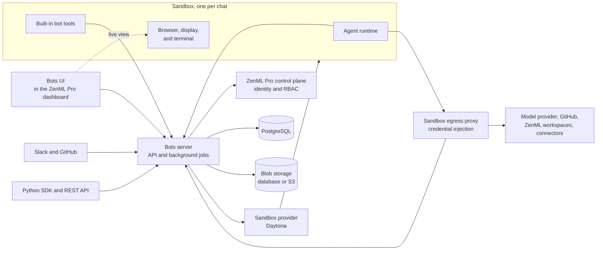

# Bots System Architecture

Bots run coding agents for your ZenML Pro organization. Every chat gets its own sandbox, a remote computer with a browser, a terminal, and a checkout of your repositories. The agent works inside that sandbox while you watch its browser and terminal, steer it with new messages, or connect to it over SSH. This page describes the services behind Bots, how a message travels from you to the agent and back, where data lives, and the network and security boundaries a platform admin needs to know.

For the objects users work with, such as bots, environments, chats, and automations, see [Bots core concepts](bots-core-concepts.md). For who may do what, see [Bots roles and permissions](bots-rbac.md). For an introduction, see the [Bots overview](bots.md).

## Bots Services

| Service | Purpose | Deployment Location |
|---------|---------|---------------------|
| [**Bots UI**](#bots-ui) | Chats, bots, environments, automations, connectors, and channel settings | Part of the ZenML Pro dashboard |
| [**Bots server**](#bots-server) | API for every client, authentication, sandbox lifecycle, message relay, Slack and GitHub delivery, scheduled automations | ZenML infrastructure |
| [**PostgreSQL**](#where-data-lives) | The only datastore of the Bots server, including its job queue | ZenML infrastructure |
| [**Blob storage**](#where-data-lives) | Attachments and artifact payloads, kept in PostgreSQL or in an S3 bucket | ZenML infrastructure |
| [**Sandbox egress proxy**](#credentials-stay-outside-the-sandbox) | HTTPS proxy that all sandbox traffic goes through. It swaps placeholder credentials for real ones on approved hosts. | ZenML infrastructure |
| [**Sandbox provider**](#sandboxes) | Creates, starts, stops, snapshots, and restores sandboxes, and issues SSH access and signed view URLs | Daytona |
| [**Sandbox**](#sandboxes) | The computer a chat's agent works on | Daytona, one per chat |
| **MCP endpoint** | Optional endpoint for external MCP clients. It holds no keys and forwards the caller's credential to the Bots server. | ZenML infrastructure |

### Bots UI

The Bots UI is part of the ZenML Pro dashboard and calls the Bots server from the browser. It shows the conversation of a chat as a live event stream, embeds the sandbox browser and terminal, and holds the pages where users configure bots, environments, automations, connectors, and their Slack and GitHub links.

### Bots server

The Bots server serves the API that the UI, the Python SDK, Slack, GitHub, and the sandboxes call. It is responsible for:

- **Authentication:** Exchanging a ZenML Pro credential for a Bots session token and checking permissions against the ZenML Pro control plane
- **Configuration:** Storing bots, environments, automations, connectors, and channel installations for each organization
- **Chats:** Storing messages and agent events, and streaming them to the UI
- **Sandbox lifecycle:** Starting a sandbox when a chat needs one, stopping idle sandboxes, waking them for the next message, and building environment snapshots
- **Channels:** Receiving Slack and GitHub events, and posting reports, questions, files, and screenshots back to the thread
- **Automations:** Starting chats from scheduled triggers
- **Credential broker:** Answering the sandbox egress proxy with the credential a sandbox request needs

Background work such as starting sandboxes, updating Slack and GitHub threads, and building snapshots runs as jobs in the same server process. The job queue lives in PostgreSQL, so the server needs no message broker or cache.

### Sandboxes

The sandbox is a separate component that owns a computer and nothing else. The Bots server creates it from the chat's environment, runs commands in it, issues SSH access, exposes ports, and snapshots or restores it through the sandbox provider. Everything that runs inside, including the agent itself, is a command the server starts there.

A runner inside every sandbox supervises:

- **The agent runtime**, which runs the agent on the configured model and connects back to the Bots server
- **A virtual display with a Chromium browser**, started on the agent's first browser use or the first time someone opens the live view
- **A terminal**, shared between the agent and the people watching
- **The built-in bot tools**, which let the agent publish artifacts, ask the user a question, and report a result

Environments can be prebuilt into snapshots, so a new chat starts from a sandbox where the repositories are already cloned and the setup command has already run.

## How Bots Fit into ZenML Pro

The Bots server is a service of the ZenML Pro control plane, next to your workspaces. It relies on the control plane for identity and permissions and keeps no user directory of its own.

**Sign-in:** The ZenML Pro dashboard exchanges the user's ZenML Pro credential for a Bots session token scoped to one organization. Browsers receive it as a cookie with a CSRF token, and SDK clients receive it as a bearer token. SDK clients can also send a ZenML Pro API key or service account key directly. The server mirrors each ZenML Pro user into a local account the first time they sign in. Session tokens expire and are not refreshed, so users sign in again after the token lifetime.

**Organizations:** Every Bots object belongs to a ZenML Pro organization, and some can also be tied to a workspace. The server stores only the organization and workspace ids and keeps no copy of their records. Objects of another organization behave as if they do not exist.

**Permissions:** The server asks the control plane whether a user may perform an action and which objects they may see, authenticating with its own client credentials. If the control plane is unreachable, these requests fail instead of falling back to open access. See [Bots roles and permissions](bots-rbac.md) for the roles and actions.

**Bots and workspaces:** Every bot is tied to a ZenML Pro service account, whose API key the server stores encrypted. Inside the sandbox, the ZenML and Kitaru clients sign in as that service account. The agent therefore sees exactly the workspaces, projects, and pipelines that the service account may access, and you control a bot's reach in ZenML Pro with the service account's roles. The server looks up the workspace servers of those workspaces in the control plane and preconfigures the clients with them.

**Context:** A chat started from a page in the ZenML Pro dashboard carries pointers to that page's workspace, project, pipeline run, or other resource. The server stores the pointer, not the resource. The agent reads the resource from the workspace server when it needs it.

## How a Request Flows

### From the UI

1. A user sends a message in a chat. The Bots server stores it and, when the chat has no running sandbox, queues a job to start one.
2. The job creates a sandbox from the chat's environment, or from its snapshot, through the sandbox provider. A chat whose sandbox was stopped wakes the same sandbox, with its files intact. The server writes the proxy settings and placeholder credentials into the sandbox and starts the runner.
3. The agent runtime connects to the Bots server from inside the sandbox. It waits for commands such as new messages and interrupts, and pushes back what the agent does: messages, reasoning, tool calls, terminal commands, and screenshots. The conversation always flows over connections the sandbox opens, so nothing has to reach into the sandbox network.
4. The server stores these events and streams them to the UI as server-sent events.
5. While it works, the agent calls the model provider, GitHub, your ZenML workspaces, and attached connectors. All of this traffic goes through the sandbox egress proxy, which adds the credentials. The built-in bot tools call the server with a token that is valid for this one chat only.
6. To show the browser or the terminal, the UI asks the server for access and receives signed, time-limited URLs from the sandbox provider. The user's browser then connects to the sandbox provider directly. SSH access works the same way with a short-lived SSH command.
7. When the agent ends its turn with a report or a question, the server records it. When configured, a classifier decides whether a turn without a report needs input from the user, and a language model names and summarizes the chat.
8. After the sandbox has been idle for a few minutes, the server stops it. The next message wakes it.

### From Slack and GitHub

An Organization Admin installs the ZenML Bots Slack app into a Slack workspace, or the ZenML Bots GitHub App into a GitHub account, from the Bots UI. Each user then links their Slack or GitHub identity to their bots account once. Messages from users who have not linked are answered with a hint and otherwise dropped, so every chat started from a thread belongs to a known ZenML Pro user and is subject to that user's Bots permissions.

Slack and GitHub deliver events to public webhook endpoints of the Bots server, which verifies every request with the app's signing or webhook secret. A mention or a direct message starts a chat bound to its thread, and replies in the thread steer the agent. From there the chat follows the same flow as in the UI. The server posts the agent's reports and questions to the thread with a link to the chat in the UI. Questions with choices arrive as Slack forms, and files and screenshots the agent shares are uploaded with the report.

### From the SDK and API

The Python SDK and the REST API expose the same operations as the UI. A script or service authenticates with a ZenML Pro API key or a service account key, selects the organization, and can then create bots, start chats, send messages, and read events. [Automations](bots-core-concepts.md) start chats from a schedule without anyone being present.

## Where Data Lives

| Data Type | Description | Location |
|-----------|-------------|----------|
| **Users, organizations, teams, roles** | Identity and permissions | ZenML Pro control plane |
| **Accounts** | Local mirror of the ZenML Pro users who used Bots | Bots database |
| **Configuration** | Bots, environments, automations, connectors, Slack and GitHub installations | Bots database |
| **Chats** | Messages, agent events, reports, questions, and feedback | Bots database |
| **Secrets** | Bot service account keys, environment secrets, connector keys and OAuth tokens, Slack bot tokens | Bots database, encrypted |
| **Attachments and artifacts** | Files users attach and outputs the agent publishes | Bots database or S3 |
| **Working files** | Repository checkouts and files the agent creates | Sandbox disk, kept while the sandbox exists |
| **Environment snapshots** | Prebuilt sandboxes with repositories and setup applied | Sandbox provider |
| **ML metadata** | Pipelines, runs, artifacts, and models the agent reads or creates | Your ZenML workspace servers. The Bots database stores only pointers. |
| **Agent traces** | Prompts, tool calls, and model responses of the agent | The Langfuse project configured for agent traces |
| **Server model calls** | Chat naming, summaries, and turn classification | The Langfuse projects configured for them |

## Deployment

ZenML runs Bots as a shared managed service that serves all ZenML Pro organizations. The Bots server, the egress proxy, and the database run in ZenML infrastructure, and sandboxes run on Daytona. The Bots server is registered with the control plane, which knows the client credentials it authenticates with.


Bots are currently available as a shared ZenML-managed service only. Enrolled deployments, where you run Bots for your own organization, are coming soon. Your ZenML workspaces can still be SaaS, hybrid, or self-hosted. The agent reaches a workspace server from its sandbox, so the workspace server must be reachable from the sandbox provider's network for a bot to work with it.


## Security Considerations

### Network Boundaries

| From | To | Purpose | Authentication |
|------|----|---------|----------------|
| Browser and SDK | Bots server | All user requests | Bots session token, or a ZenML Pro credential |
| Bots server | ZenML Pro control plane | Sign-in, permission checks, workspace lookup | Client credentials of the Bots server |
| Slack and GitHub | Bots server webhooks | Messages, mentions, form answers | Signing secret or webhook secret |
| Bots server | Slack and GitHub | Thread replies and file uploads | Installation tokens |
| Bots server | Sandbox provider | Create, run commands, stop, snapshot | Provider API key |
| Sandbox | Bots server | Agent events, commands, attachments, built-in tools | Token valid for one chat |
| Sandbox | Sandbox egress proxy | All outbound HTTPS traffic | Signed, short-lived sandbox token |
| Sandbox egress proxy | Bots server | Credential lookup | Shared proxy secret. This endpoint is not public. |
| Browser | Sandbox provider | Live browser view and terminal | Signed, time-limited URL |
| User workstation | Sandbox | SSH | Short-lived SSH token |

Only the public API paths of the Bots server are routed from the internet. The credential endpoint of the egress proxy is reachable only inside the Bots deployment, and the proxy itself may only reach public addresses, the Bots server, and DNS.

### Credentials Stay Outside the Sandbox

The sandbox runs code the agent writes, so real credentials are kept out of it. Every sandbox sends its outbound traffic through the egress proxy, which is always on and runs [agentgateway](https://agentgateway.dev). The sandbox receives placeholders for the GitHub tokens, the bot's ZenML Pro service account key, the chat token of the Bots server, connector credentials, and the OpenAI key. The egress proxy decrypts each outbound HTTPS request with a certificate authority the sandbox trusts, checks the sandbox's signed token, and asks the Bots server for the credential that belongs to the destination. It then replaces the placeholder in the request.

- Credentials are added only for the destinations listed in the sandbox's token, such as GitHub, the ZenML Pro API, and the model provider. Requests to other hosts pass through without credentials, so the agent can browse the public web. The list is not a browsing allowlist.
- A connector credential is added only for that provider's approved endpoint and only when the connector is attached to the chat's bot. If the check fails, the request is denied.
- The proxy caches credential lookups for a few minutes, so a revoked or changed connector can stay usable in a running chat until its cached entry expires.
- The keys of the Langfuse project that receives agent traces do reach the sandbox. Use a Langfuse project that holds only agent traces. The values of secret environment variables are masked before traces are sent.
- A model provider other than OpenAI receives its key as an environment variable inside the sandbox, without the placeholder swap.

### Isolation

Every chat has its own sandbox, and the token the sandbox holds can write only to its own chat and read only what that chat needs, such as its messages, attachments, and environment. Bots act in ZenML Pro with their own service account, so their reach is limited by that account's roles rather than by the user who started the chat. Data of different organizations is separated in every query, and an object from another organization is reported as not found.

## Related Documentation

- [Bots overview](bots.md) - What Bots are and how to start
- [Bots core concepts](bots-core-concepts.md) - Bots, environments, chats, automations, and connectors
- [Bots roles and permissions](bots-rbac.md) - Who may do what in Bots
- [System Architecture](system-architecture.md) - The ZenML Pro control plane and workspace servers
- [Service Accounts](service-accounts.md) - Managing the service accounts bots run as

<figure><figcaption></figcaption></figure>
