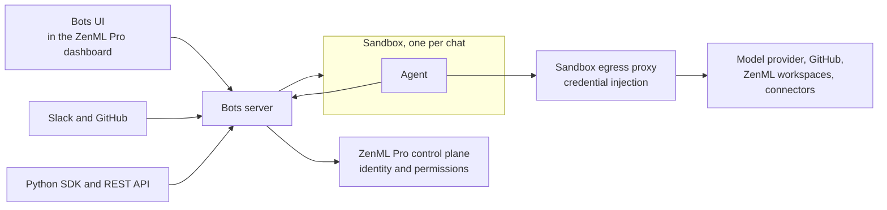

# Bots System Architecture

Bots run coding agents for your ZenML Pro organization. Every chat gets its own sandbox, a remote computer with a checkout of your repositories. This page explains how Bots fit into ZenML Pro, where your data lives, and how sandboxes keep credentials safe.

For the objects users work with, such as bots, environments, chats, and automations, see [Bots core concepts](bots-core-concepts.md). For who may do what, see [Bots roles and permissions](bots-rbac.md). For an introduction, see the [Bots overview](bots.md).

## How Bots Fit into ZenML Pro

The Bots server is a service of the ZenML Pro control plane, next to your workspaces. It relies on ZenML Pro for identity and permissions.

**Sign-in:** You sign in to Bots with your ZenML Pro account, and scripts use a ZenML Pro API key or service account key. Every session works in one organization.

**Permissions:** ZenML Pro roles decide what you may do in Bots. If ZenML Pro cannot be reached, requests are denied instead of allowed. See [Bots roles and permissions](bots-rbac.md).

**Bots and workspaces:** Every bot acts as a ZenML Pro service account. Inside the sandbox, the ZenML and Kitaru clients are signed in as that service account, so the agent sees exactly the workspaces, projects, and pipelines that the service account may access. You control a bot's reach with the service account's roles.

**Context:** A chat started from a page in the ZenML Pro dashboard carries a pointer to that page's workspace, project, pipeline run, or other resource. The agent reads the resource from the workspace when it needs it.

## How a Chat Runs

1. You send a message from the UI, Slack, GitHub, or the SDK. When the chat has no running sandbox, one is started from the chat's environment. A stopped sandbox starts again with its files intact.
2. The agent works in the sandbox. Its messages, reasoning, commands, and tool calls stream to the chat live.
3. While it works, the agent calls the model provider, GitHub, your ZenML workspaces, and attached connectors. All of this traffic goes through the sandbox egress proxy, which adds the credentials.
4. SSH uses short-lived access that you request from the chat.
5. The agent ends its turn with a report or a question. Chats started from Slack or GitHub receive them in their thread.
6. After the sandbox has been idle for a few minutes, it is stopped. The next message starts it again.

## Where Data Lives

| Data Type | Location |
|-----------|----------|
| **Users, organizations, teams, roles** | ZenML Pro control plane |
| **Bots configuration and chats** | Bots database, in ZenML infrastructure |
| **Secrets** such as service account keys, environment secrets, and connector credentials | Bots database, encrypted |
| **Attachments and artifacts** | Bots storage, in ZenML infrastructure |
| **Working files** such as repository checkouts | Sandbox disk, kept while the sandbox exists |
| **ML metadata** such as pipelines, runs, artifacts, and models | Your ZenML workspaces. Bots store only pointers to them. |

## Deployment


Bots are currently available as a shared ZenML-managed service only. Your ZenML workspaces can still be SaaS, hybrid, or self-hosted. The agent reaches a workspace from its sandbox, so the workspace server must be reachable from the internet for a bot to work with it.


## Security Considerations

### Credentials Stay Outside the Sandbox

The sandbox runs code the agent writes, so real credentials are kept out of it. Every sandbox sends its outbound traffic through an egress proxy. The sandbox only holds placeholders for the GitHub token, the bot's ZenML Pro service account key, and connector credentials. The proxy replaces a placeholder with the real credential on its way out, and only for the destination the credential belongs to.

- Credentials are added only for approved destinations such as GitHub, the ZenML Pro API, and the model provider. Requests to other hosts pass through without credentials, so the agent can still browse the public web.
- GitHub credentials only cover the repositories configured in the bot's environment, and only those the ZenML Pro GitHub app has access to.
- A connector credential is added only when the connector is attached to the chat's bot.
- Changes to a connector can take a few minutes to reach a running chat.
- The API key of a [custom MCP server](bots-core-concepts.md#custom-mcp-servers) connector is placed in the sandbox, because the server runs there.

### Isolation

Every chat has its own sandbox, and the sandbox can only write to its own chat. Bots act in ZenML Pro with their own service account, so their reach is limited by that account's roles rather than by the user who started the chat. Data of different organizations is kept apart, and a resource of another organization is reported as not found.

### Slack and GitHub

Installs of the Slack and GitHub apps are bound to the browser that started them, so a forwarded install link connects nothing. A GitHub installation is only connected for the owner of the GitHub user account or an owner of the GitHub organization. Messages from Slack and GitHub users who have not linked their account are not acted on.

## Related Documentation

- [Bots overview](bots.md) - What Bots are and how to start
- [Bots core concepts](bots-core-concepts.md) - Bots, environments, chats, automations, and connectors
- [Bots roles and permissions](bots-rbac.md) - Who may do what in Bots
- [System Architecture](system-architecture.md) - The ZenML Pro control plane and workspace servers
- [Service Accounts](service-accounts.md) - Managing the service accounts bots run as

<figure><figcaption></figcaption></figure>
