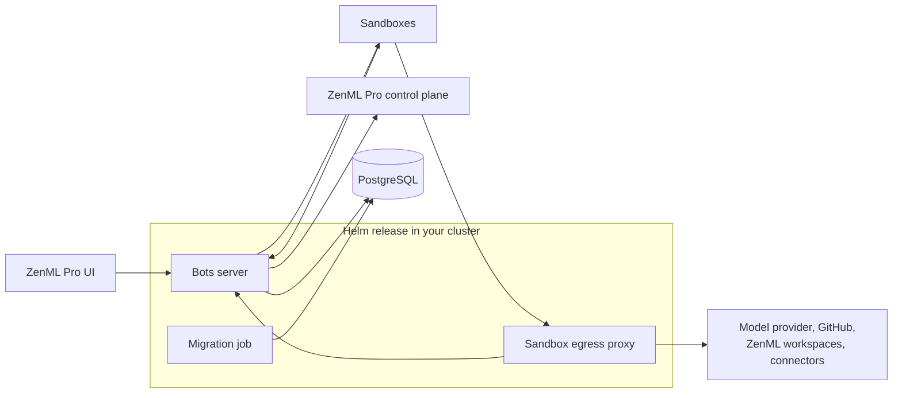

# Self-hosted Bots Deployment on Kubernetes with Helm

This guide provides step-by-step instructions for deploying the ZenML Pro Bots server on Kubernetes using Helm and enrolling it in the ZenML Pro control plane. For what Bots are and how they work, see the [Bots overview](bots.md) and the [Bots system architecture](bots-system-architecture.md).

A self-hosted Bots server works with both deployment scenarios in which you run infrastructure yourself:

- **[Hybrid](hybrid-deployment.md):** The control plane is managed by ZenML. The Bots server, its database, and the sandbox egress proxy run in your infrastructure.
- **[Self-hosted](self-hosted-deployment.md):** The control plane, the Bots server, its database, and the sandbox egress proxy all run in your infrastructure.

A self-hosted Bots server serves exactly one ZenML Pro organization.

## Deployment Architecture



### Architecture Components

The Helm chart deploys the following components into one namespace:

- **Bots server:** Serves the Bots API that the ZenML Pro UI, the Python SDK, Slack, and GitHub talk to. It also starts and stops the sandboxes.
- **Migration job:** Updates the database schema before every install and upgrade.
- **Sandbox egress proxy:** Receives all outbound traffic of the sandboxes and adds credentials on the way out. Real credentials never enter a sandbox.

You provide the PostgreSQL database and the sandbox provider that the sandboxes run on.

### Sandbox Providers

Every chat runs in its own sandbox. The Bots server creates the sandboxes on one of the following providers:

| Provider | Where sandboxes run |
|----------|---------------------|
| Daytona | In your [Daytona](https://www.daytona.io/) account |
| Kubernetes | As pods in a Kubernetes cluster that you operate |


The Kubernetes sandbox provider is not released yet. This guide configures Daytona.


## Prerequisites

Before starting, make sure you go through the [general prerequisites for hybrid deployments](deploy-prerequisites.md). Particular requirements for a Bots deployment are listed below.

**Infrastructure:**
- Kubernetes cluster (1.24+) that enforces NetworkPolicy
- PostgreSQL database with one role for the server and one role that may change the schema
- Account with a sandbox provider
- API key for a model provider
- Optional: S3-compatible bucket for attachments and artifacts

**Network:**
- Hostname with a TLS certificate for the Bots server, served through a Gateway API gateway or an Ingress controller
- Hostname with a TLS certificate for the sandbox egress proxy

The following connections must be possible:

| From | To | Purpose |
|------|----|---------|
| Browsers of your users | Bots server | The ZenML Pro UI calls the Bots API directly |
| Bots server | ZenML Pro control plane | Sign-in, permissions, and status reports |
| Bots server | Sandbox provider API | Creating and stopping sandboxes |
| Sandboxes | Bots server | Chat messages and results of the agent |
| Sandboxes | Sandbox egress proxy | All other outbound traffic of the agent |
| Sandbox egress proxy | Model provider, GitHub, ZenML workspaces, connectors | Requests of the agent |
| Slack and GitHub | Bots server | Only when the [Slack](#optional-connect-slack) or [GitHub](#optional-connect-github) app is enabled |

With Daytona, the sandboxes run outside your cluster, so the Bots server and the sandbox egress proxy must be reachable from Daytona.

**Tools (on a machine with internet access for initial setup):**
- Helm (3.0+)
- OpenSSL

## Install the Bots Server

### Step 1: Enroll the Bots Deployment in the ZenML Pro Control Plane

A self-hosted Bots server must be enrolled in a ZenML Pro organization before it can be deployed. [Contact ZenML](mailto:cloud@zenml.io) to enroll your deployment. You receive the following enrollment credentials:

- the bot deployment ID
- the enrollment key
- the organization ID

### Step 2: Create Kubernetes Secrets

The Bots server reads all its credentials from Kubernetes Secrets that you create before installing the chart.

```bash
# Create namespace for the Bots server
kubectl create namespace zenml-pro-bots
```

**Runtime Secret.** The Bots server reads its credentials from the keys of this Secret.

```bash
kubectl -n zenml-pro-bots create secret generic bots-runtime \
  --from-literal=databasePassword=<server-role-password> \
  --from-literal=secretEncryptionKey="$(openssl rand -hex 32)" \
  --from-literal=jwtSigningKey="$(openssl rand -hex 32)" \
  --from-literal=controlPlaneClientSecret=<enrollment-key> \
  --from-literal=daytonaApiKey=<daytona-api-key> \
  --from-literal=piProviderApiKey=<model-provider-api-key> \
  --from-literal=sandboxEgressProxySecret="$(openssl rand -hex 32)" \
  --from-file=sandboxEgressSigningKey=signing-key.pem
```


`secretEncryptionKey` encrypts the secrets stored in the Bots database. Keep a copy of it. Stored secrets cannot be read with a different key.


`signing-key.pem` is the private key the server signs sandbox tokens with:

```bash
openssl genpkey -algorithm EC -pkeyopt ec_paramgen_curve:P-256 -out signing-key.pem
```

**Migration Secret.** The migration job connects with a database role that may change the schema. This Secret must be a different one than the runtime Secret.

```bash
kubectl -n zenml-pro-bots create secret generic bots-migration \
  --from-literal=databaseUser=<migration-role> \
  --from-literal=databasePassword=<migration-role-password>
```

**Database CA Secret.** The certificate of the CA that signed the certificate of your database.

```bash
kubectl -n zenml-pro-bots create secret generic bots-database-ca \
  --from-file=ca-cert.pem=<path-to-database-ca-certificate>
```

**Sandbox egress proxy Secret.** The proxy needs its own CA to add credentials to the HTTPS requests of the sandboxes. Every sandbox trusts the certificate of this CA. The Secret also holds the public key of `signing-key.pem` as a JWKS file, which the proxy verifies sandbox tokens with.

```bash
# Create the CA of the sandbox egress proxy
openssl ecparam -name prime256v1 -genkey -noout -out ca-key.pem
openssl req -x509 -new -key ca-key.pem -days 3650 \
  -subj "/CN=zenml-pro-bots-sandbox-egress-ca" \
  -addext "basicConstraints=critical,CA:TRUE" \
  -addext "keyUsage=critical,keyCertSign,cRLSign" \
  -out ca-cert.pem

kubectl -n zenml-pro-bots create secret generic bots-sandbox-egress \
  --from-file=ca-cert.pem=ca-cert.pem \
  --from-file=ca-key.pem=ca-key.pem \
  --from-file=jwks.json=jwks.json
```

### Step 3: Configure Helm Values for the Bots Server

The example below is a basic configuration for a Bots server that runs its sandboxes on Daytona and is served through a Gateway API gateway.

```yaml
environment: production

image:
  repository: <BOTS_SERVER_IMAGE_REPOSITORY>
  digest: sha256:<BOTS_SERVER_IMAGE_DIGEST>

# Set up imagePullSecrets to authenticate to the container registry where the
# Bots container images are hosted, if necessary
imagePullSecrets: []

config:
  # The URL of the ZenML Pro UI
  dashboardUrl: https://zenml-pro.my.domain
  corsAllowOrigins: https://zenml-pro.my.domain
  # The public URL of the Bots server
  serverUrl: https://bots.my.domain

  # The enrollment credentials from Step 1
  controlPlaneApiUrl: https://zenml-pro-api.my.domain
  controlPlaneClientId: <bot-deployment-id>
  controlPlaneDeploymentId: <bot-deployment-id>
  controlPlaneOrganizationId: <organization-id>

  # The PostgreSQL database
  databaseHost: postgres.my.domain
  databasePort: 5432
  databaseUser: <server-role>
  databaseName: bots

  # The sandbox provider
  sandboxProvider: daytona
  runnerSnapshot: <DAYTONA_SNAPSHOT_NAME>

  # The model the agents run on, and the environment variable the model
  # provider reads its API key from
  runtimeBackend: pi
  piModel: <provider>/<model>
  piProviderApiKeyEnv: <PROVIDER_API_KEY_VARIABLE>

# The Secrets from Step 2
secrets:
  existingSecret: bots-runtime

migration:
  existingSecret: bots-migration

databaseTls:
  sslMode: verify-full
  existingSecret: bots-database-ca

sandboxEgress:
  enabled: true
  caSecret:
    existingSecret: bots-sandbox-egress
  config:
    # The URL the sandboxes reach the proxy at
    proxyUrl: https://bots-egress.my.domain

# Expose the Bots server through an existing Gateway API gateway
httpRoute:
  enabled: true
  hostnames:
    - bots.my.domain
  parentRef:
    name: <gateway-name>
    namespace: <gateway-namespace>
    sectionName: <listener-name>

networkPolicy:
  # The address range of the network that the database is in
  vpcCidr: 10.0.0.0/16
```

In a hybrid deployment, `dashboardUrl` and `corsAllowOrigins` are `https://cloud.zenml.io`, and `controlPlaneApiUrl` is `https://cloudapi.zenml.io`. In a fully self-hosted deployment, they are the URLs of your own ZenML Pro UI and control plane API.

Note the following:

- With `environment: production` the chart rejects inline secret values, container images without a digest, and a database connection that does not verify the server certificate.
- The sandbox egress proxy listens on port 3128 of the Service `<release-name>-sandbox-egress`. Expose that Service to your sandboxes under the hostname of `sandboxEgress.config.proxyUrl`, for example with a load balancer that terminates TLS (`sandboxEgress.service`). Restrict the source addresses to those of your sandbox provider.
- The chart installs NetworkPolicies that only allow the connections the components need. A cluster that serves the Bots server through an Ingress controller must set `networkPolicy.enabled: false` and `ingress.enabled: true` in place of the `httpRoute` section.
- To store attachments and artifacts in a bucket and not in the database, set `blobStorage.backend: s3` and `blobStorage.s3.bucket`. Grant the service account of the Bots server access to the bucket through workload identity (`serviceAccount.annotations`).

### Step 4: Deploy the Bots Server with Helm

```bash
helm install zenml-pro-bots <BOTS_HELM_CHART> \
  --version <BOTS_CHART_VERSION> \
  --namespace zenml-pro-bots \
  --values zenml-pro-bots-values.yaml
```

The migration job runs first. When it fails, the installation stops before the Bots server starts.

Verify deployment:

```bash
kubectl -n zenml-pro-bots get pods
kubectl -n zenml-pro-bots get svc
kubectl -n zenml-pro-bots get httproute
```

### Step 5: Access Bots in the ZenML Pro UI

The Bots server reports its URL and version to the control plane once it is running. No further configuration of the ZenML Pro UI is necessary.

1. Open the ZenML Pro UI in your browser
2. Sign in and select the organization the Bots deployment was enrolled in
3. Open Bots and [create your first bot](bots.md)

## (Optional) Connect Slack

Chats can be started and steered from Slack. A self-hosted Bots server needs its own Slack app, because a Slack app sends its events to exactly one server.

1. Go to [api.slack.com/apps](https://api.slack.com/apps) and create an app from a manifest. Use the Slack app manifest provided by ZenML and replace `<host>` with the hostname of your Bots server. Slack verifies the URLs of the manifest when the app is saved, so the Bots server must already be reachable from the internet.
2. Copy the client ID, the client secret, and the signing secret from the Basic Information page of the app.
3. Add the keys `slackClientSecret` and `slackSigningSecret` to the runtime Secret.
4. Enable Slack in the Helm values and upgrade the release:

    ```yaml
    config:
      slackEnabled: true
      slackClientId: <slack-client-id>
    ```

5. Install the app into your Slack workspace from the Bots settings in the ZenML Pro UI. See [Channels](bots-core-concepts.md#channels).

## (Optional) Connect GitHub

The GitHub app gives sandboxes access to your repositories and lets you start chats from issues and pull requests. A self-hosted Bots server needs its own GitHub app.

1. Create a GitHub app in the settings of your GitHub organization. Fill the form with the name, webhook URL, callback URLs, events, and permissions of the GitHub app manifest provided by ZenML, with `<host>` replaced by the hostname of your Bots server.
2. Enable "Request user authorization (OAuth) during installation" and put `https://<host>/api/v1/github/install/callback` first in the list of callback URLs. Do not configure a setup URL.
3. From the settings page of the app, take the app ID, the client ID, and the webhook secret. Generate a client secret and a private key there. The app slug is the name in the URL of the app.
4. Add the keys `githubClientSecret`, `githubWebhookSecret`, and `githubPrivateKey` to the runtime Secret.
5. Enable GitHub in the Helm values and upgrade the release:

    ```yaml
    config:
      githubEnabled: true
      githubAppId: "<github-app-id>"
      githubAppSlug: <github-app-slug>
      githubClientId: <github-client-id>
      # The ID that https://api.github.com/users/<github-app-slug>[bot] returns.
      # Sandboxes author their commits as this user.
      githubBotUserId: "<github-bot-user-id>"
    ```

6. Install the app on your GitHub organization from the Bots settings in the ZenML Pro UI. An installation started from the app page on GitHub is not connected. See [Channels](bots-core-concepts.md#channels).

## Day 2 Operations

**Upgrades:** Run `helm upgrade` with the new chart version and image digest. The migration job updates the database schema before the Bots server is replaced. Running chats continue, and the server finishes the work it has started before it stops.

**Rotating Secrets:** A change to a Secret does not restart the pods. Restart them after you change one:

```bash
kubectl -n zenml-pro-bots rollout restart deployment
```

**Scaling:** The Bots server can run multiple replicas. Set `api.autoscaling.enabled: true` to scale it with a HorizontalPodAutoscaler.

## Related Resources

- [Bots overview](bots.md)
- [Bots system architecture](bots-system-architecture.md)
- [Hybrid SaaS Deployment](hybrid-deployment.md)
- [Self-hosted Deployment Overview](self-hosted-deployment.md)
- [Helm Documentation](https://helm.sh/docs/)

## Support

For self-hosted and hybrid SaaS/self-hosted deployments, contact ZenML Support:
- Email: [cloud@zenml.io](mailto:cloud@zenml.io)
- Provide: Deployment status, configuration details and any error logs

<figure><figcaption></figcaption></figure>
