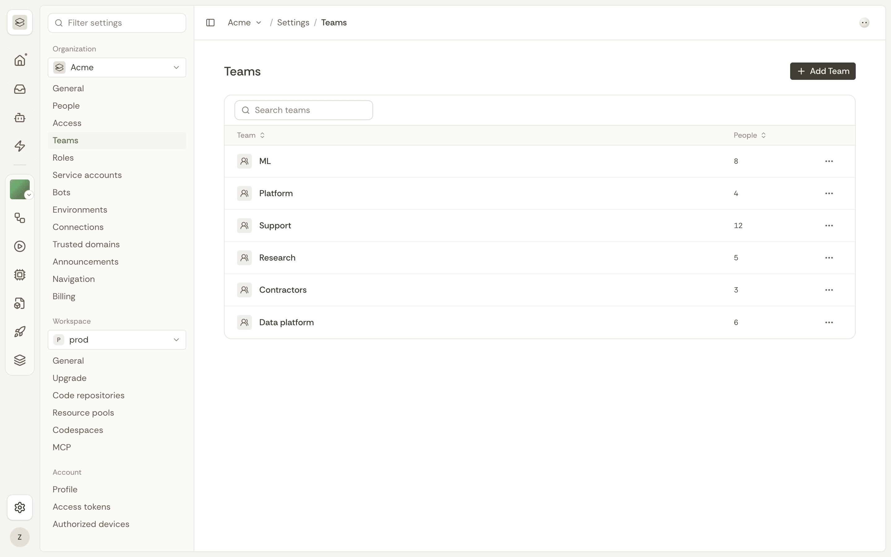
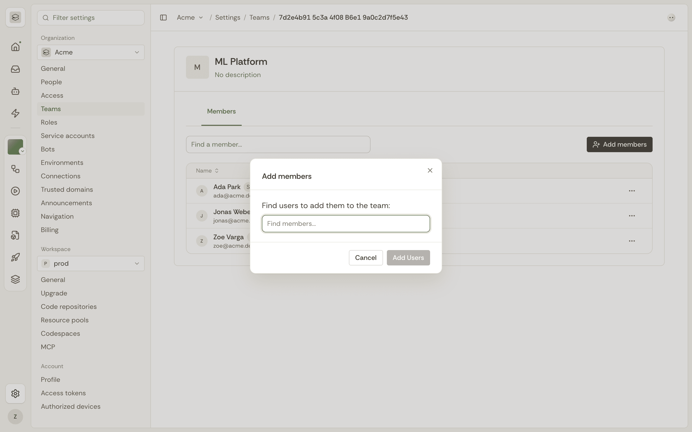
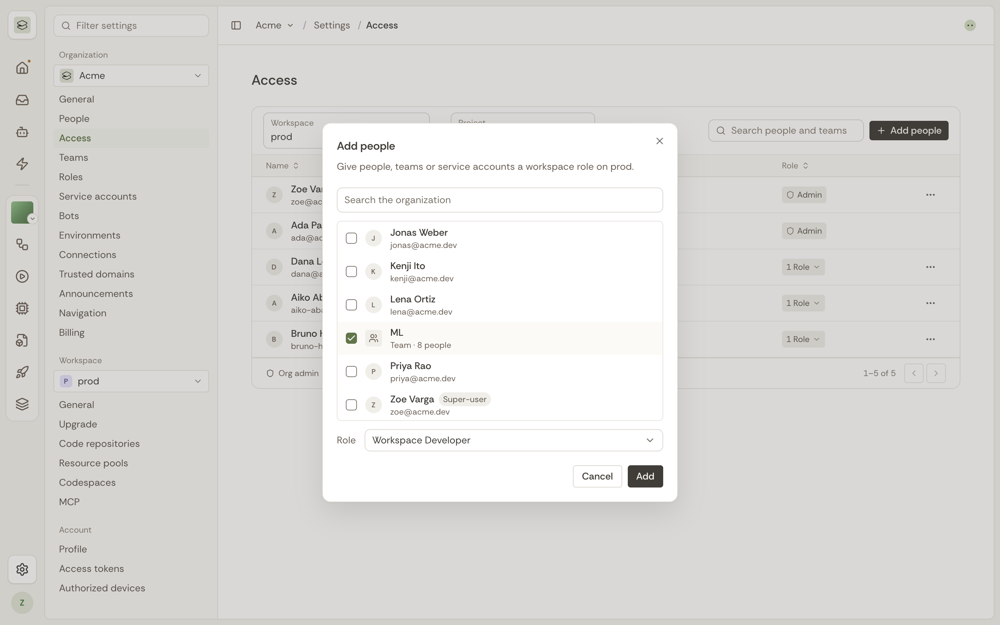
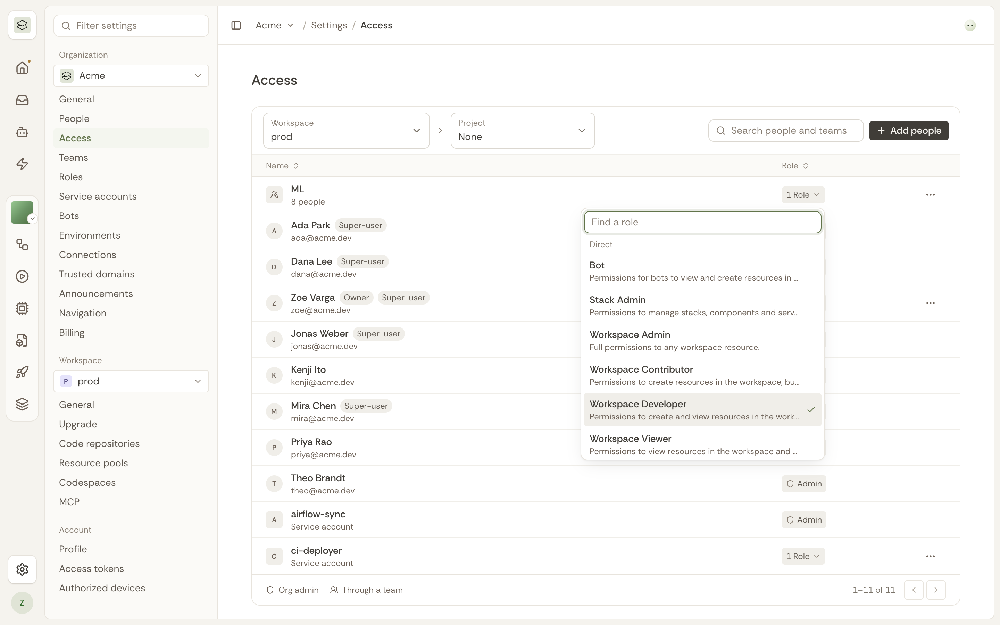

# Teams

ZenML Pro introduces the concept of Teams to help you manage groups of users efficiently. A team is a collection of users that acts as a single entity within your organization and workspaces. This guide will help you understand how teams work, how to create and manage them, and how to use them effectively in your MLOps workflows.

## Understanding Teams

Teams in ZenML Pro offer several key benefits:

1. **Group Management**: Easily manage permissions for multiple users at once.
2. **Organizational Structure**: Reflect your company's structure or project teams in ZenML.
3. **Simplified Access Control**: Assign roles to entire teams rather than individual users.

## Creating and Managing Teams

Teams are created at the organization level and can be assigned roles within workspaces, similar to individual users.

To create a team:



**Go to the Organization Settings**

Select **Settings** at the foot of the rail, then open the **Organization** pages.

<figure><figcaption></figcaption></figure>



**Open Teams**

Open **Settings**, then **Teams** under **Organization**.




**Add a New Team**

Select **Add Team**.

<figure><figcaption></figcaption></figure>

When creating a team, you'll need to provide:

* Team Name
* Description (optional)



## Adding Users to Teams

To add users to an existing team:



Open **Settings**, then **Teams** under **Organization**



Select the team you want to modify



Select **Add members**



Choose users from your organization to add to the team




## Assigning Teams to Workspaces

Teams can be assigned to workspaces just like individual users. To add a team to a workspace:



Open **Settings**, then **Access** under **Organization**



Pick the workspace in the **Workspace** picker.



Select **Add people**



Choose the team and assign a role




## Team Roles and Permissions

When you assign a role to a team within a workspace, all members of that team inherit the permissions associated with that role. This can be a system role (Workspace Admin, Workspace Developer, Workspace Contributor, Workspace Viewer) or a custom role you've created.

For example, if you assign the Workspace Developer role to a team on a workspace, all members of that team are Workspace Developers on that workspace.

## Best Practices for Using Teams

1. **Reflect Your Organization**: Create teams that mirror your company's structure or project groups.
2. **Combine with Custom Roles**: Use custom roles with teams for fine-grained access control.
3. **Regular Audits**: Periodically review team memberships and their assigned roles.
4. **Document Team Purposes**: Maintain clear documentation about each team's purpose and associated projects or workspaces.

By leveraging Teams in ZenML Pro, you can streamline user management, simplify access control, and better organize your MLOps workflows across your organization and workspaces.

<figure><figcaption></figcaption></figure>
